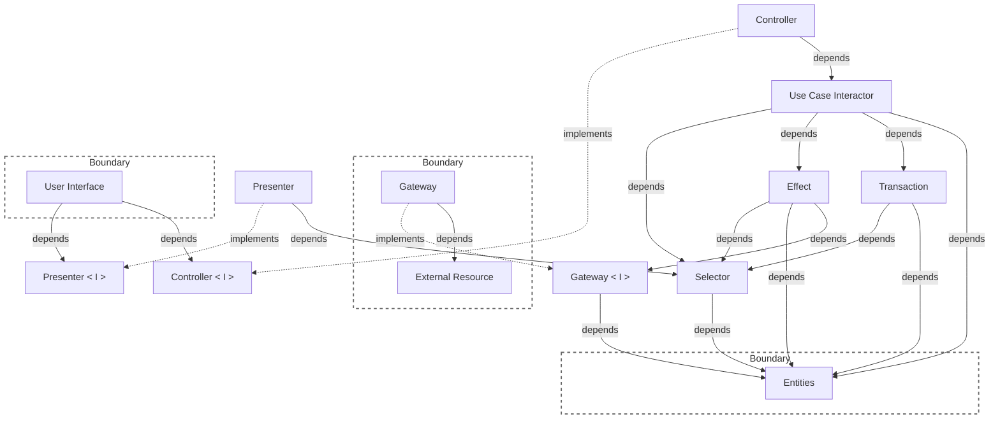

# Clean Reactive Architecture

Clean Architecture implemented for reactive (observer-pattern) client apps:
SPAs and mobile apps. The diagram shows units - responsibilities - not files
or folders.

For a React project, also read `references/react.md`. It maps the units onto
React + Redux Toolkit and lists the conventions to follow.

## Units

| Unit | Responsible for |
| --- | --- |
| `user interface` | Displays what the presenter prepared, captures input and hands it to the controller. |
| `presenter` | Converts entity data into the shape the UI needs (ViewModels). Read only. |
| `controller` | Converts UI input into a use case call. |
| `use case interactor` | Orchestrates one user goal: calls effects/gateways, applies transactions. Owns concurrency (cancel, drop, wait, rollback). |
| `selector` | Derives values or aggregates from entities without modifying them. |
| `transaction` | Moves entities from one valid state to another, keeping business rules. |
| `effect` | Manages I/O flows to, from and across gateways (sequential, parallel), derives data from them. Optional. |
| `entities` | Holds enterprise and application business data and rules (e.g. `idle/loading/error`, session, route, form, selection state). |
| `gateway` | Implements `gateway<I>`. Translates to and from the external resource. |
| `external resource` | Servers, storage, devices, libraries with an API. |

`selector`, `transaction` and `effect` are units that share logic between the
units that depend on them. Selectors are shared by presenters, use cases,
transactions and effects. Transactions and effects are shared by use cases.

## Concepts behind the units

- **Enterprise business rules and data**: would exist even if the application
  didn't. They are independent of any specific application.
- **Enterprise business entity**: encapsulates enterprise business rules and
  data.
- **Application business rules and data**: specific to the application's
  functionality. They don't exist outside of it.
- **Application business entity**: encapsulates application business rules and
  data. It is persistent, observable state with its own validity rules and a
  lifetime longer than any single use case call. It is state with rules, not
  orchestration logic, so it belongs in `entities`, not in a use case.
  Examples:
  - operation state: `idle` / `loading` / `error`
  - initialization state: `uninitialized` / `initializing` / `ready`
  - session state: `authenticated` / `refreshing` / `expired`
  - route state
  - form state: values, dirty flags, validation, submission
  - connectivity state
  - selection state

  Framework or library state, such as the router or a toast library, is an
  application business entity and the source of truth. Don't duplicate it.
- **State**: the data of entities at a given point in time.
- **Valid state**: one of a finite number of states that the enterprise and
  application rules allow. For example, `idle` can't carry an error message,
  and `error` can't move to `loading` without an explicit retry. Transactions
  move entities only between valid states.

`<I>` is a contract declared by the unit that **uses** it, not by the one that
implements it: the UI declares `presenter<I>` and `controller<I>`, the use case
(or effect) declares `gateway<I>`. A type of a value is enough; it need not be
a language `interface`.

Boundaries surround the `user interface`, the `entities`, and the `gateway` +
`external resource`. Data crosses them only as primitives or plain data
structures (DTOs, plain objects).

## Dependencies

The diagram is the specification. A dependency not on it is not allowed.

What this rules out, and why:

- `presenter` never calls a use case, effect or gateway. The read path has no
  side effects, so display changes can't change business decisions.
- `controller` never reads presenter properties. When it needs current state,
  it reads it through the same selectors the presenter uses, or directly from
  entities. A decision on the write path is never made from data prepared for
  display.

## Two paths

- **Write path:** `user interface` → `controller` → `use case` →
  (`effect` → `gateway`) → `transaction` → `entities`.
- **Read path:** `entities` → `selector` → `presenter` → `user interface`.

They meet only at the entities. No unit between the UI and the entities sits on
both paths. The UI observes the entities. Nothing pushes values to the screen.
Fetching data to fill entities is a write path (use case + gateway), even if it
is "only a read".

## Related concepts

- **ViewModel**: the plain value each presenter property returns. It has no
  behavior or identity.
- **Repository**: a composite of `gateway` + `entities` in code. It implements
  a `gateway<I>` the consumer declared and never defines that contract itself.
  It may hide caching and invalidation. If it loads data when read, rely on
  that. If not, start the load explicitly from a controller/use case (e.g. on
  mount).
- **Driver**: anything that drives the core through a controller, observes it
  through a presenter, or both: the UI, a test harness, a deep link, a
  WebSocket listener. Each driver has its own controllers/presenters. The core
  (use cases, entities, `gateway<I>`) is shared. Reactions (state change → use
  case) are a driver's job.
- **Composition root**: fractal. `main` is the bootstrap root, each component
  is the root of its own units. A unit lives with the composition that owns it.
  To share an entity or extend its lifetime, lift it to a higher root.
- **Errors**: behind `gateway<I>` the core sees only core error types. The use
  case turns them into transactions (error state, toast state).
