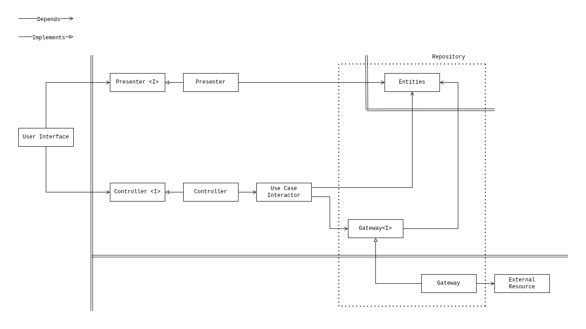
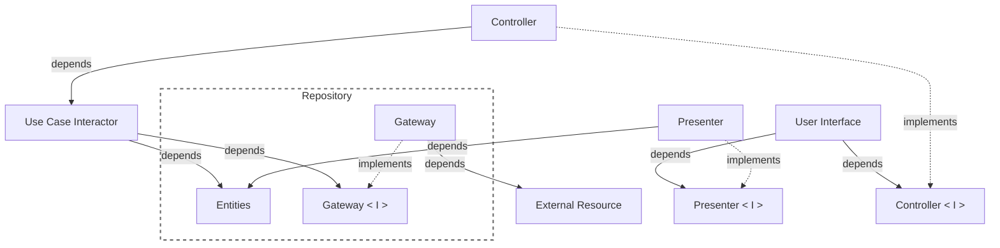
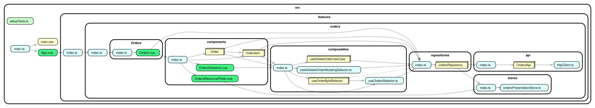

# Clean Reactive Architecture — Vue Sample

A sample application that demonstrates
[Clean Reactive Architecture](https://github.com/clean-reactive/documentation/blob/main/docs/architecture.md)
implemented with Vue.

The sample shows a concrete, working mapping of every architectural unit from
the diagram to idiomatic Vue code.

> :bulb: **Architecture reference implementation.** `components/Order` keeps its presenter, controller, and use case separate so the architecture is visible. Simpler components inline their units. This is a demonstration choice, not a rule that every component must follow. See the [Development Methodology](https://github.com/clean-reactive/documentation/blob/main/docs/methodology.md).

> :bulb: **Multiple data resources.** The repository accesses either an in-memory resource or a remote API through the same gateway contract. This demonstrates substituting resource implementations without changing the consuming units. Multiple resources and runtime switching are included for demonstration purposes, not required by the architecture.

## Getting started

Install dependencies:

```sh
npm ci
```

Start the development server:

```sh
npm run dev
```

## Tech stack

- [Vue](https://vuejs.org/) 3
- [TanStack Query](https://tanstack.com/query/latest) (`@tanstack/vue-query`)
- [TypeScript](https://www.typescriptlang.org/)
- [Vite](https://vitejs.dev/)
- [Tailwind CSS](https://tailwindcss.com/) + [daisyUI](https://daisyui.com/)
- [Vitest](https://vitest.dev/) + [Testing Library](https://testing-library.com/)
- [MSW](https://mswjs.io/) for network-level HTTP interception in gateway tests
- [dependency-cruiser](https://github.com/sverweij/dependency-cruiser) for dependency validation and graph visualization

## Architecture mapping

The table below shows how each unit from the Clean Reactive Architecture diagram
maps to this codebase. Locations are relative to `src/features/orders`.

| Architectural unit              | Vue / TanStack equivalent                  | Location                                                                                                                  |
| ------------------------------- | ------------------------------------------ | ------------------------------------------------------------------------------------------------------------------------- |
| Application business entity     | Store object backed by a Vue `ref`         | `stores/ordersPresentationStore.ts`                                                                                       |
| Enterprise business entity      | TypeScript type                            | `repositories/ordersRepository/ordersRepository.types.ts`                                                                 |
| Gateway interface               | TypeScript interface                       | `OrdersGateway` in `repositories/ordersRepository/ordersRepository.types.ts`                                              |
| Repository (gateway + entities) | Composables over TanStack Query            | `repositories/ordersRepository/ordersRepository.ts`                                                                       |
| Gateway implementation          | Factory returning `OrdersGateway`          | `repositories/ordersRepository/OrdersService/`                                                                            |
| Use case interactor             | Composable or inline operation             | `composables/useDeleteOrderUseCase`, `components/OrderItem/OrderItem.vue`                                                 |
| Selector                        | Composable returning `computed`            | `composables/useOrdersSelector.ts`, `composables/useOrderByIdSelector`, `composables/useIsDeleteOrderMutatingSelector.ts` |
| Presenter                       | Composable or inline `computed` projection | `components/Order/composables/usePresenter`, inline in simpler components                                                 |
| ViewModel                       | Plain values prepared by the presenter     | `Presenter` in `components/Order/Order.types.ts`                                                                          |
| Controller                      | Composable or inline event handlers        | `components/Order/composables/useController.ts`, inline in simpler components                                             |
| User interface                  | Vue single-file component template         | `Orders`, `components/Order`, `components/OrderItem`                                                                      |

## Key design decisions

These decisions are specific to this sample, guided by its demonstration goals
and the capabilities of Vue and the selected libraries. The architecture
defines responsibilities and boundaries without prescribing specific technical
solutions.

**Extracted units as Vue composables.** Extracted units in this sample are
implemented as composables called from a component's `<script setup>`. `Order`
deliberately extracts its presenter, controller, use case, and selectors so the
full architecture is visible. Simpler components inline units without
independent policy or reuse.

**Component setup as composition roots.** A single-file component's
`<script setup>` composes the units and wires their dependencies through
composables. Its template is the User Interface unit and reads only the
presenter and the controller.

**Self-contained Vue components.** Components own their view-facing behavior
and resolve their data within their composition boundary. Their props are
limited to identity or configuration parameters, such as `orderId` and
`itemId`, rather than receiving entity data through props. This is a deliberate
demonstration choice to reduce structural coupling, not a mandatory rule.

**Application business entity as a Vue store object.**
`OrdersPresentationStore` holds application-level state
(`ordersResource: "local" | "remote"`) that persists across use case calls and
has its own rules. It keeps the value in a private `ref` and exposes it through
a getter, so reads return a plain value while Vue still tracks them. It is not
managed by TanStack Query.

**Repository as TanStack Query composables.** `useGetOrdersQuery`,
`useDeleteOrderMutation`, and `useDeleteOrderItemMutation` combine gateway
access and observable entity state. They consume `OrdersGateway`, expose query
and mutation operations, and manage the entity cache and optimistic updates.

**Gateway selection at runtime.** `makeOrdersService(resource)` returns either
`makeInMemoryOrdersService()` or `makeRemoteOrdersService()` according to
`ordersResource`. The repository calls this factory inside each query and
mutation. The resource is part of the query key, so switching it in the
resource picker loads the selected resource without resetting the cache.

**Computed refs for reactive state.** TanStack Query composables expose refs.
Selectors derive `computed` refs from them, and `usePresenter` projects those
into a single `computed` ViewModel for the template.

## UML diagram representing application architecture



<details>
  <summary>mermaid</summary>



</details>

## Folder structure

```console
src/features
└── orders
    ├── api                         # external resource (HTTP client + API)
    ├── components                  # user interface, presenters, controllers
    │   ├── Order
    │   │   ├── composables
    │   │   │   ├── useController.ts
    │   │   │   └── usePresenter
    │   │   │       └── usePresenter.ts
    │   │   ├── Order.vue
    │   │   └── Order.types.ts
    │   ├── OrderItem
    │   │   └── OrderItem.vue        # inline presenter, controller, use case
    │   ├── OrdersResourcePicker.vue
    │   └── OrdersStatistics.vue
    ├── composables                 # use cases, selectors
    │   ├── useDeleteOrderUseCase
    │   │   └── useDeleteOrderUseCase.ts
    │   ├── useIsDeleteOrderMutatingSelector.ts
    │   ├── useOrderByIdSelector
    │   │   └── useOrderByIdSelector.ts
    │   └── useOrdersSelector.ts
    ├── Orders
    │   └── Orders.vue              # user interface + inline presenter
    ├── repositories                # repository, gateway interface, gateway implementations
    │   └── ordersRepository
    │       ├── ordersRepository.ts
    │       ├── ordersRepository.types.ts
    │       ├── ordersRepository.utils.ts
    │       └── OrdersService       # resource selection + gateway implementations
    ├── stores                      # application business entity
    │   └── ordersPresentationStore.ts
    ├── testIds.ts
    └── utils
        └── isOrdersResource.ts
```

## Further reading

- [Clean Reactive Architecture](https://github.com/clean-reactive/documentation/blob/main/docs/architecture.md)
- [Development Methodology](https://github.com/clean-reactive/documentation/blob/main/docs/methodology.md)

## Dependency graph


